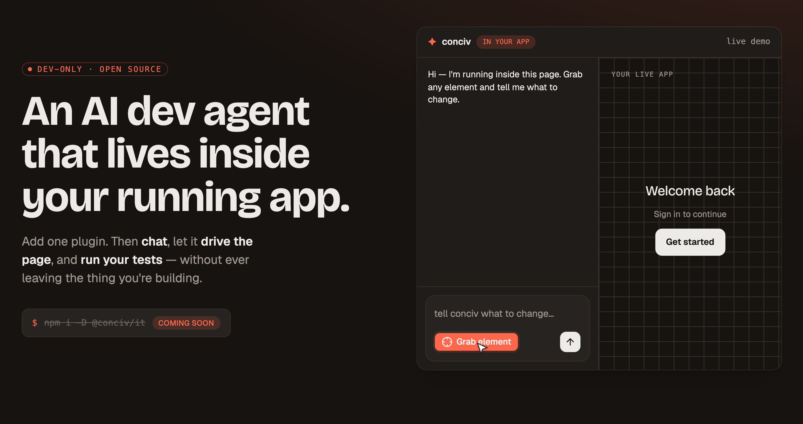
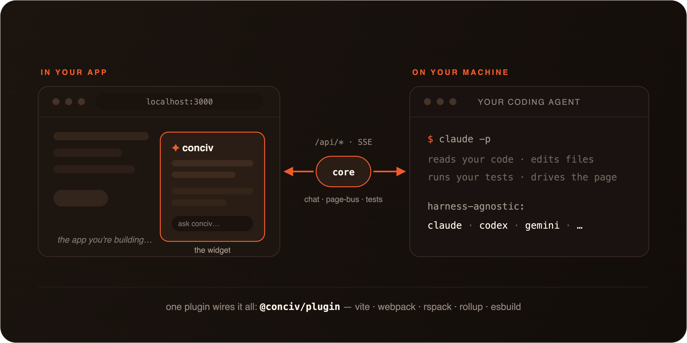

<div align="center">

<a href="https://conciv.dev">
  
</a>

<h1>✦&nbsp; conciv</h1>

<p>
  <em>Conceive it.</em>
  <br>
  <strong>Your coding agent, living inside your running app.</strong>
  <br>
  Add conciv to your build. Then chat, let it drive the page, and run your tests,
  <br>
  without ever leaving the thing you're building.
</p>

<p>
  <a href="https://conciv.dev"><strong>Website</strong></a>
  &nbsp;·&nbsp;
  <a href="./apps/examples/tanstack-start"><strong>Example app</strong></a>
  &nbsp;·&nbsp;
  <a href="./apps/site/content/docs"><strong>Docs</strong></a>
  &nbsp;·&nbsp;
  <a href="https://github.com/conciv-dev/conciv/issues"><strong>Report a bug</strong></a>
</p>

<p>
  <a href="https://www.npmjs.com/package/@conciv/it"></a>
  
  
  
  
</p>

</div>

---

## What is conciv?

**conciv** puts an AI dev agent inside the app you are already running. Add conciv to your Vite
or Next.js config, and a conciv button appears in your dev preview. Open it and you're talking to an agent that can
**see the page you're building**, **drive it**, **edit your source**, and **run your tests**, all
in the same window, without a second terminal or a context switch.

It's **dev-only** (never shipped to production) and **harness-agnostic**: it drives a real coding
CLI under the hood (Claude Code, Codex, OpenCode or Gemini CLI), so the agent is as
capable as the tool you already trust.

## Features

- 💬 &nbsp;**Chat in-app**: talk to an agent that sees your running page, streams its reasoning, and calls tools live.
- 🕹️ &nbsp;**Page control**: it grabs elements, clicks, fills, inspects React props/state, and live-edits the DOM to preview changes.
- 🧪 &nbsp;**Live tests**: add the test runner plugin and the agent runs your Vitest or Playwright tests and reads the results.
- 🧩 &nbsp;**Plugins**: drop a plugin in `conciv/plugins/` and the agent gets a new tool and RPC methods you can call from the terminal, plus panels and buttons in the widget if you build a browser half.
- 🎨 &nbsp;**Shared whiteboard**: add the whiteboard plugin for a canvas you and the AI draw on together, with source-anchored comments.
- ✅ &nbsp;**Approvals**: when the agent asks for permission, a card in the thread lets you approve or deny it.
- 🔌 &nbsp;**Vite and Next.js**: dev-only, never in your production bundle. webpack and Rspack start the engine without the widget, in dev and also during a production build.
- 🤝 &nbsp;**Harness-agnostic**: Claude Code, Codex, OpenCode and Gemini CLI behind one capability interface.
- 🌘 &nbsp;**Zero style leak**: the widget lives in an open Shadow DOM, isolated from your app's CSS.

## How it works

<div align="center">
  
</div>

The conciv build integration (`@conciv/unplugin`) starts a framework-free **hono** engine
(`@conciv/core`) on its own port on `127.0.0.1`, which runs the harness (Claude Code by default),
and injects a Solid widget into your page. The first time a browser opens the widget, it asks for
a 6-digit code the dev server prints in its terminal.

## Try it live

No install needed: open [conciv.dev](https://conciv.dev), click "Try it live", and paste the
pairing prompt into Claude Code (or run the `npx @conciv/try` command it shows). The widget on
the landing page connects to the agent on your machine. Everything stays local: the core binds
`127.0.0.1` only, gated by a one-time token, and prompts never touch our servers.

## Quickstart

```sh
npx @conciv/cli@latest init
```

or install it yourself and add conciv to your app's `vite.config.ts`:

```sh
npm i -D @conciv/it
```

```ts
import {defineConfig} from 'vite'
import conciv from '@conciv/it/plugin/vite'

export default defineConfig({
  plugins: [conciv()],
})
```

Install and log in to the agent CLI you want (Claude Code by default), start your dev server, click
the conciv button in the corner of your app, and type the code your terminal prints.

Override defaults via `conciv({harness, plugins, widget, …})`. Next.js uses
`@conciv/it/plugin/nextjs`; see the [quick start](https://conciv.dev/docs/quick-start).

## Plugins

Teach the agent new tricks with a plugin in `conciv/plugins/`. The engine loads it from
TypeScript source and reloads it when you save. A tool goes to the agent; an RPC method is
callable from your browser half and from the terminal:

```ts
import {z} from 'zod'
import {Plugin} from '@conciv/plugin'
import {Hello} from './rpc.js'

export default Plugin.define({
  id: 'hello',
  async setup(ctx) {
    const greet = async (name: string) => {
      const count = Number((await ctx.storage.get('count')) ?? 0) + 1
      await ctx.storage.set('count', count)
      return {message: `Hello, ${name}!`, count}
    }
    await ctx.tool.transform((tools) => {
      tools.add({
        name: 'hello_greet',
        description: 'Greet someone by name',
        input: z.object({name: z.string()}),
        output: z.object({message: z.string(), count: z.number()}),
        execute: async ({name}) => ({output: await greet(name)}),
      })
    })
    const registration = await ctx.rpc.register(Hello, {greet: async ({name}) => greet(name)})
    return () => registration.dispose()
  },
})
```

```sh
conciv plugin call hello greet --data '{"name":"Ada"}'
# {"ok":true,"data":{"message":"Hello, Ada!","count":1}}
```

Installable plugins go in `conciv({plugins: [...]})`: `@conciv/plugin-tanstack`,
`@conciv/plugin-test-runner`, `@conciv/plugin-recorder` and `@conciv/plugin-whiteboard`. See
[Plugins](https://conciv.dev/docs/plugins).

## Supported tools

| Area          | Full support                             | In progress                                    |
| ------------- | ---------------------------------------- | ---------------------------------------------- |
| **Harnesses** | Claude Code, Codex, OpenCode, Gemini CLI | Pi                                             |
| **Bundlers**  | Vite, Next.js                            | webpack, Rspack (engine only), Rollup, esbuild |
| **Tests**     | Vitest, Playwright                       | Jest, `node:test`                              |

## Packages

Install these:

| Package                               | What it is                                                                                                |
| ------------------------------------- | --------------------------------------------------------------------------------------------------------- |
| [`@conciv/it`](./packages/it)         | **The one you install.** Thin umbrella: `@conciv/it/plugin/vite`, `/nextjs`, `/webpack`, `/rspack`.       |
| [`@conciv/plugin`](./packages/plugin) | The plugin SDK: `Plugin.define` for the engine and browser halves, `Rpc.define`, stores, the Vite preset. |
| [`@conciv/try`](./packages/try)       | `npx @conciv/try --token <t>`: try conciv live on conciv.dev with the agent already on your machine.      |

Under the hood:

| Package                                                        | What it is                                                                                                               |
| -------------------------------------------------------------- | ------------------------------------------------------------------------------------------------------------------------ |
| [`@conciv/protocol`](./packages/protocol)                      | Shared wire types + `define*` factories (chat, generative UI, test, page, harness). Zero-runtime.                        |
| [`@conciv/core`](./packages/core)                              | The framework-free hono engine: every `/api/*` route, session, uiBus, harness + test registries.                         |
| [`@conciv/harness`](./packages/harness)                        | Harness adapters behind a capability interface: Claude, Codex, OpenCode, Gemini CLI, plus a Pi stub.                     |
| [`@conciv/unplugin`](./packages/unplugin)                      | The build integration: Vite and Next.js boot core and inject the widget; webpack and Rspack boot core only.              |
| [`@conciv/embed`](./packages/embed)                            | The browser half: mounts the conciv Solid app into an open Shadow DOM, with the chat UI, cards, and page-control driver. |
| [`@conciv/cli`](./packages/cli)                                | The `conciv` CLI: `init`, `auth`, `mcp`, and `plugin call` for plugin methods.                                           |
| [`@conciv/plugin-host`](./packages/plugin-host)                | The engine's plugin host: loads, reloads and supervises plugins, their tools, skills and RPC.                            |
| [`@conciv/plugin-whiteboard`](./packages/plugins/whiteboard)   | Separate install: the shared canvas with AI drawing and source-anchored comments.                                        |
| [`@conciv/plugin-test-runner`](./packages/plugins/test-runner) | Separate install: runs your Vitest or Playwright tests for the agent.                                                    |

## Documentation

Full docs live at **[conciv.dev](https://conciv.dev)** and in
[`apps/site/content/docs`](./apps/site/content/docs): quick-start guides per bundler, usage
(chat, page control, live tests, approvals), harness and test-runner configuration, and
troubleshooting.

## Repository blueprint

Every package, app and source directory carries a `README.md` with its interface, invariants, side effects and the command that verifies it. Start from the three top-level blueprints and follow the links down.

### Subdirectories & System Boundaries

- packages: [packages/README.md](./packages/README.md) - the npm packages: engine and plugin, shared contracts, the browser widget and UI kits, host framework SDKs, and private repo tooling.
- apps: [apps/README.md](./apps/README.md) - the widget UI (`@conciv/app`), the conciv.dev site, the Storybook and the example host apps.
- native: [native/README.md](./native/README.md) - the Swift ConcivWidget iOS SDK and the ConcivDemo app.

### Global Invariants

- Everything is ESM, Node >= 26, one pnpm workspace with catalog-pinned dependencies and turbo as the task graph.
- Code shared between the browser and Node lives in a contract package (`protocol`, `contract`, `grab`) or a plugin's `rpc.ts` contract; the browser never imports a server entry.
- A plugin is an engine half, an optional RPC contract and an optional prebuilt browser half (`plugin-experimental.cjs`), as opencode's plugins are. The public package set is `PUBLIC_PACKAGES` in `packages/publish`, and every other `@conciv/*` package is internal to `@conciv/it`.
- The engine binds loopback only; cross-origin access is gated by the Host/Origin middleware in `packages/core/src/lib`.

### Global Side Effects

- The engine writes its SQLite database, port file and endpoint discovery file under the project's state directory and `~/.conciv`.
- Harness adapters read the user's agent transcripts (`~/.claude`, `~/.codex`, `~/.pi`, opencode's database) and spawn the agent binaries.
- The conciv build integration boots the engine process and injects the widget meta tags and script into served HTML.
- `conciv-publish` publishes to npm, pushes git tags and force-pushes the `conciv-swift` mirror.

### System Verification

- Run: `pnpm typecheck && pnpm lint && pnpm test` at the repo root (turbo runs every package), or `pnpm test:affected` for packages changed since `origin/main`.

## Contributing

Issues and PRs are welcome. This is a young project moving fast, so the best first step is to run the
[example app](./apps/examples/tanstack-start), find something rough, and open an issue.

```sh
pnpm install
pnpm dev        # runs the tanstack-start example with conciv wired in
```

See [`CONTRIBUTING.md`](./CONTRIBUTING.md) for setup, everyday commands, and PR guidelines.

## Star history

<a href="https://www.star-history.com/#conciv-dev/conciv&Date">
  <picture>
    <source media="(prefers-color-scheme: dark)" srcset="https://api.star-history.com/svg?repos=conciv-dev/conciv&type=Date&theme=dark">
    <source media="(prefers-color-scheme: light)" srcset="https://api.star-history.com/svg?repos=conciv-dev/conciv&type=Date">
    
  </picture>
</a>

## License

[MIT](./LICENSE) © conciv

<div align="center">
  <br>
  <sub><strong>conciv</strong> · as in <code>@conciv/it</code>. Say it out loud.</sub>
  <br>
  <sub>Built with hono, Solid, and a real coding agent living in the page.</sub>
</div>
